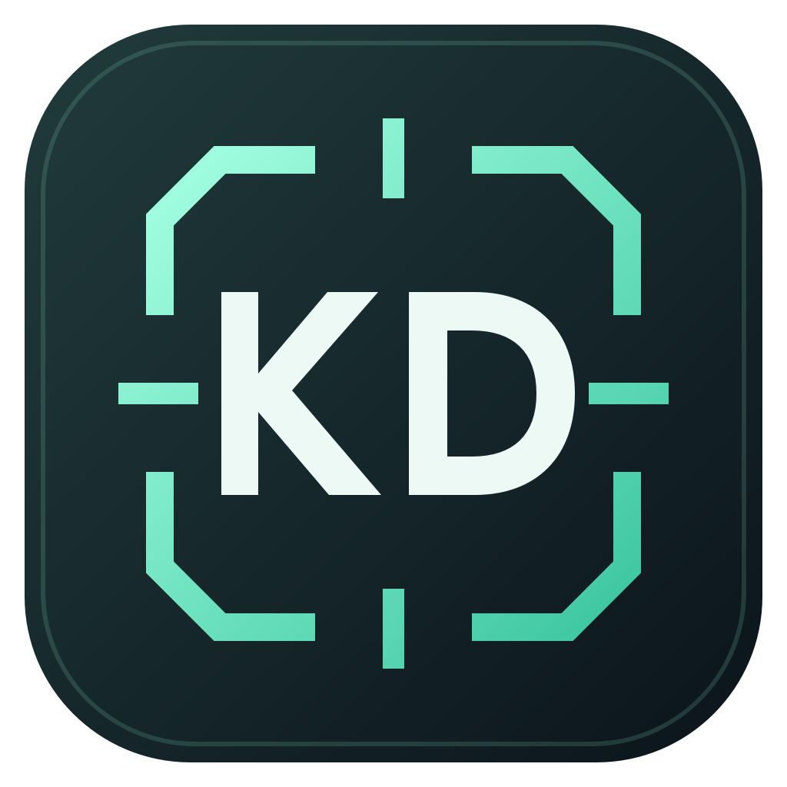

# 暗区战绩 · ABI KD Counter

适用于《暗区突围：无限》中文客户端的 Windows 本地战绩统计工具。
通过作战报告截图识别，或自动逐场打开游戏历史战绩，统计特遣队员淘汰数。

**[下载 Windows 版](https://github.com/SHISGAY114514/abi-kd-counter/releases/latest)** · [使用说明](使用说明.txt) · [更新记录](CHANGELOG.md)



## 功能

- 主页显示战局数、普通 / 封锁 / 强化封锁 KD、击败特遣队员数。
- 拖入、多选或粘贴作战报告截图，离线 OCR 识别地图、难度、结果及特遣淘汰数。
- 自动采集当前游戏可见历史：建立清单、展开报告、保存截图、返回翻页、补扫遗漏。
- F8 停止、切换窗口停止、中断后继续；结果独立暂存，核对后合并。
- 已有对局不覆盖，合并前自动备份；支持 CSV 导出、备份和恢复。

## 使用

Windows 10/11 x64。下载 Release 中的 `ABI-KD-1.2.2-Windows-x64.zip`，解压后运行 EXE；无需安装 Python、注册账号或配置 API Key。

首次运行是空数据库。数据存于 `%LOCALAPPDATA%\ABI-KD`，升级时关闭旧版再运行新版，已有战绩会保留。公开源码和安装包不包含个人战绩、游戏截图或账户信息。

自动采集前，在游戏内打开 **个人主页 → 历史战绩**，然后在软件中点击 **自动采集 → 开始自动采集**。采集期间保持游戏在前台，不要操作鼠标；按 **F8** 可随时停止。结束后核对结果，勾选确认，再合并新增记录。

只覆盖游戏当前能展示的历史；已经消失的旧记录会继续保留在本机数据库。实机验证环境为中文界面、1440×1080 中的居中 16:9 画面。其他布局、低清画面或客户端更新可能需要适配，异常会停止或标为待核对。

## 统计与识别原理

截图在本机交给 RapidOCR / ONNX Runtime 识别，结合字段标签和位置提取数据。特遣淘汰数取“淘汰特遣队员数”，不使用含 AI 的总淘汰数。自动采集从历史列表取得对局日期；手动截图往往不含日期，需要核对导入时间。

撤离类 KD = 特遣队员淘汰数 ÷ 撤离失败场次。这是本工具的明确口径，并不保证等同于游戏官方全生涯 KD。团队模式使用报告里的实际被击败次数，单独统计；感染区计入封锁、重度感染区计入强化封锁，两者均计入战局数和特遣淘汰总数；其他活动和团队模式不进入主页指标。原始记录仍保留原难度，KD 以合并后的淘汰数与撤离失败场次计算，不对各模式 KD 求平均。关键字段未知的对局不参与 KD。

程序只截图并发送普通鼠标点击和滚轮，不读取游戏内存、不注入进程。没有云端 OCR、遥测或截图上传。

## 开发与构建

使用 Windows、Python 3.12 x64 和 PowerShell：

```powershell
py -3.12 -m venv .venv
.\.venv\Scripts\python.exe -m pip install -r requirements.txt
.\.venv\Scripts\python.exe app.py
.\.venv\Scripts\python.exe -m pytest -q
.\build.ps1
```

输出为 `dist-public/ABI-KD-1.2.2.exe`。构建脚本优先使用本地 `.python`、其次 `.venv`、最后 PATH 中的 Python。图标源文件为 SVG，可以自行修改再构建。

打包检查必须使用独立数据目录：

```powershell
$env:ABI_KD_DATA_DIR = Join-Path $PWD 'qa-public'
& .\dist-public\ABI-KD-1.2.2.exe --smoke-test
# 退出后检查 qa-public/smoke-test.json
Remove-Item Env:ABI_KD_DATA_DIR
```

测试使用合成文字图与虚构记录，不依赖私人战绩。`ABI_KD_DATA_DIR` 仅供隔离测试或自定义数据目录使用。

## 许可

项目原创代码和图标使用 [MIT](LICENSE)。依赖按各自许可证分发，见 [第三方说明](THIRD_PARTY_NOTICES.md) 和 `THIRD_PARTY_LICENSES`。这是社区工具，与游戏开发商、发行商无隶属关系；游戏名称归相关权利人所有。
